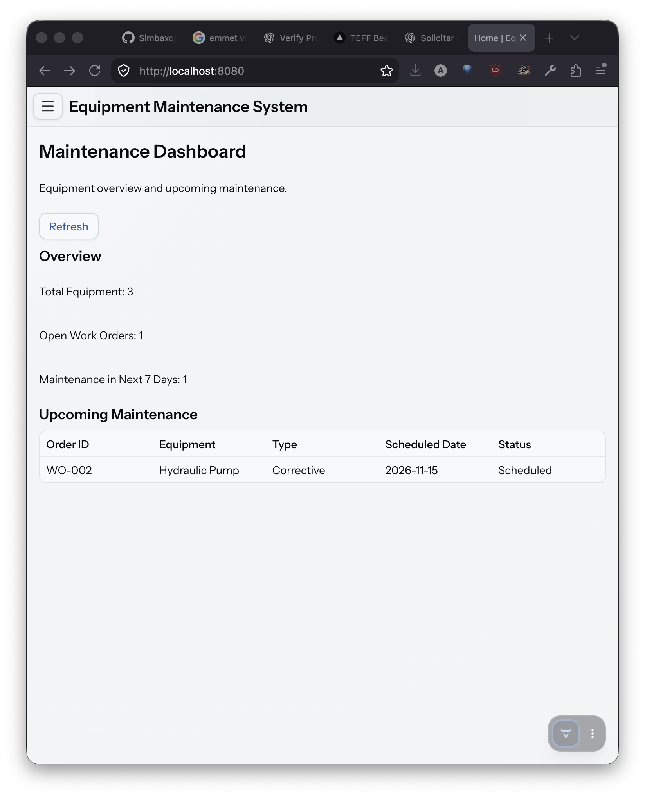
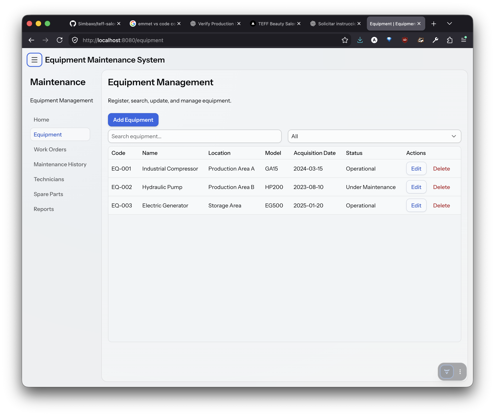
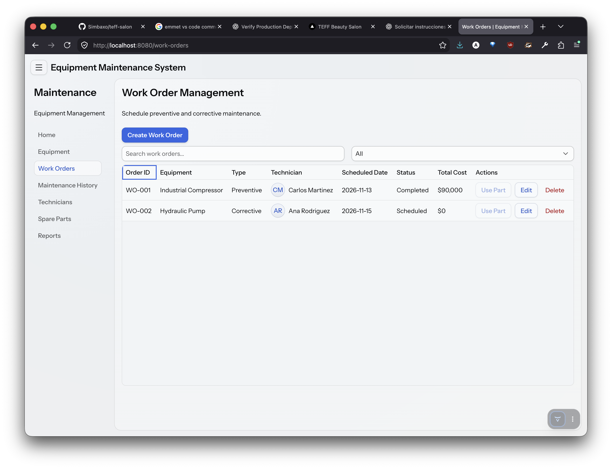
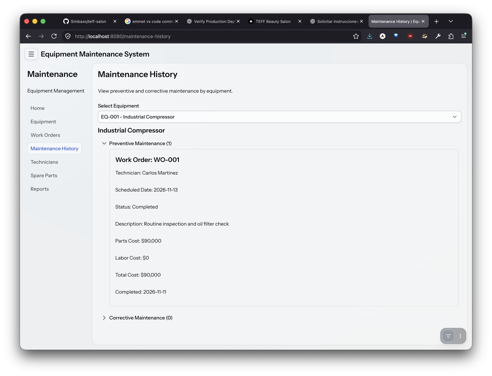
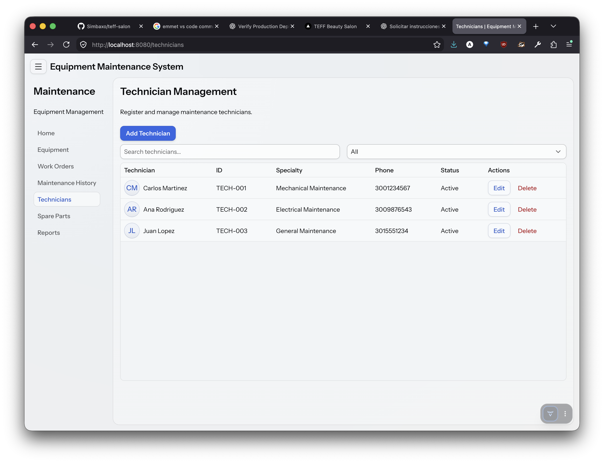
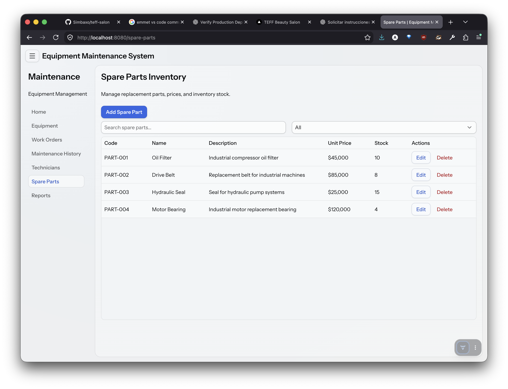
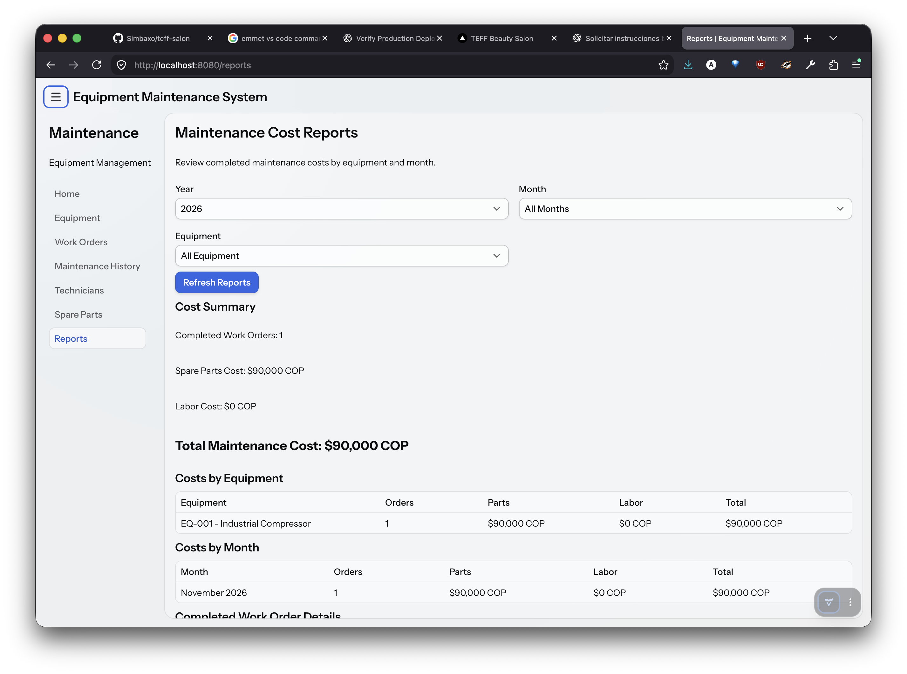

# Equipment Maintenance System

**Final Project – Programming Logic**

**Student:** Andres Felipe Mena Murillo  
**University:** Universidad Pontificia Bolivariana (UPB)  
**Project:** 14 – Equipment Maintenance  
**Date:** November 11, 2026

## 1. Project Description

The Equipment Maintenance System is a web application developed using Java and Vaadin.

The application is designed for a small industrial facility that needs to organize equipment, technicians, maintenance work orders, and spare parts.

The main goal is to keep maintenance information organized, track maintenance expenses, and identify upcoming maintenance activities.

## 2. Technologies Used

- Java 21
- Vaadin 25
- Spring Boot 4
- Maven
- Text files (`.txt`) for data storage
- Visual Studio Code

The application does not use a database or paid Vaadin components.

## 3. Main Features

### Equipment Management
- Register new equipment.
- View, edit, and delete equipment.
- Search equipment by code, name, location, or model.
- Filter equipment by status.

### Technician Management
- Register and manage technicians.
- Assign technicians to maintenance work orders.
- Display technician initials using Vaadin Avatar.

### Spare Parts Inventory
- Register spare parts with their prices and stock quantities.
- Add, edit, search, and delete spare parts.
- Automatically reduce inventory when parts are used in work orders.

### Work Orders
- Create preventive and corrective maintenance orders.
- Select equipment and assign technicians.
- Record scheduled dates, descriptions, and status.
- Record spare parts and labor costs.
- Mark maintenance orders as completed.

### Maintenance History
- View maintenance records for each piece of equipment.
- Separate preventive and corrective orders using Vaadin Accordion.

### Maintenance Dashboard
- View equipment and open work-order totals.
- Identify maintenance scheduled within the next seven days.

### Reports
- View completed maintenance costs by equipment.
- View maintenance costs by month.
- Separate spare-parts and labor costs.
- Filter reports by year, month, and equipment.

## 4. Required Vaadin Components

Three Vaadin components were researched and implemented:

**Accordion:** Used to display preventive and corrective maintenance history in expandable sections.

**Select:** Used to select maintenance types, technicians, and equipment.

**Avatar:** Used to identify technicians using their names and initials.

The application also uses Grid, TextField, ComboBox, DatePicker, Dialog, FormLayout, and Notification.

## 5. How to Run the Application

### Requirements

- Java JDK 21
- Node.js 24
- npm 11
- An internet connection for downloading Maven dependencies during initial setup

### Instructions

1. Clone or download this repository.
2. Open the project folder in Visual Studio Code.
3. Make sure Java 21 is selected.
4. Open a terminal in the project folder.
5. Run the application:

```bash
./mvnw spring-boot:run
```

6. Open a browser and visit:

`http://localhost:8080`

The application creates sample data files automatically if they do not exist.

## 6. User Manual

### Registering Equipment

1. Open the Equipment section.
2. Click "Add Equipment".
3. Enter the required information.
4. Click "Save".
5. The new equipment appears in the table.

Equipment can also be searched, filtered, edited, and deleted.

### Managing Technicians

1. Open Technicians.
2. Click "Add Technician".
3. Complete the technician information.
4. Click "Save".

### Managing Spare Parts

1. Open Spare Parts.
2. Click "Add Spare Part".
3. Enter the part information, price, and quantity.
4. Save the part.

### Creating a Maintenance Order

1. Open Work Orders.
2. Click "Create Work Order".
3. Select the equipment.
4. Choose Preventive or Corrective maintenance.
5. Select a technician.
6. Enter the description and scheduled date.
7. Save the work order.

### Using Spare Parts

1. Open an existing work order.
2. Change its status to "In Progress".
3. Click "Use Part".
4. Select a spare part and quantity.
5. Confirm the operation.

The application reduces the available stock and updates the work-order cost.

### Completing Maintenance

1. Open Work Orders.
2. Edit an existing work order.
3. Change the status to "Completed".
4. Save.

The completion date is stored automatically.

### Viewing Reports

1. Open Reports.
2. Select the year and month.
3. Optionally select equipment.
4. Review the maintenance costs.

## 7. Data Storage

The application saves information in text files located in the `data` folder.

| File | Information |
|---|---|
| `equipment.txt` | Registered equipment |
| `technicians.txt` | Technician information |
| `spare-parts.txt` | Spare-parts inventory |
| `work-orders.txt` | Maintenance work orders |
| `work-order-parts.txt` | Spare parts used in work orders |

Each field is separated by the `|` character.

The information is saved between application restarts. The file readers use error handling to prevent incorrectly formatted records from stopping the application.

## 8. Sample Data

The project includes example records for testing.

Examples include:

- Industrial Compressor (EQ-001)
- Hydraulic Pump (EQ-002)
- Electric Generator (EQ-003)
- Carlos Martinez (TECH-001)
- Oil Filter (PART-001)
- Preventive Maintenance Order (WO-001)

Work order WO-001 demonstrates how using two oil filters reduces inventory and records a parts cost of 90,000 COP.

## 9. Application Screenshots

### 9.1 Home Dashboard

Displays equipment totals, open work orders, and maintenance scheduled within the next seven days.



### 9.2 Equipment Management

Register, search, edit, and delete equipment.



### 9.3 Work Orders

Create preventive and corrective maintenance orders, assign technicians, and manage maintenance costs.



### 9.4 Maintenance History

View preventive and corrective maintenance records using Vaadin Accordion.



### 9.5 Technician Management

Manage technicians and identify them using Vaadin Avatar.



### 9.6 Spare Parts Inventory

Manage spare parts and monitor available stock quantities.



### 9.7 Maintenance Reports

View maintenance costs by equipment and month.



## 10. Conclusion

This project helped me practice Java programming concepts such as classes, objects, methods, loops, conditions, lists, file handling, and validation.

I also learned how to create a web application using Vaadin, connect different views, and save information in text files without using a database.